[Mermaid](https://mermaid-js.github.io/mermaid/#/)一个是很全、很强大的文本、代码绘图工具，以下是在markdown使用中的图例和方法。图例可能来源于官网，也可能是本人自制，或经本人调整。  
**如果只看到脚本而没有图，请按F5刷新**

## 在VSCode中使用

先安装VSCode插件：[Markdown Preview Enhanced](https://shd101wyy.github.io/markdown-preview-enhanced/#/)

可在配置菜单中配置。也可用命令：`Markdown Preview Enhanced: Open Mermaid Config`，例如：

```js
MERMAID_CONFIG = {
  startOnLoad: true,
  securityLevel: 'loose',
  fontFamily: '"楷体","华文楷体","仿宋","宋体"',
}
```

详细配置选项见[mermaidAPI](https://mermaid-js.github.io/mermaid/#/Setup)。

### 流程图

````text
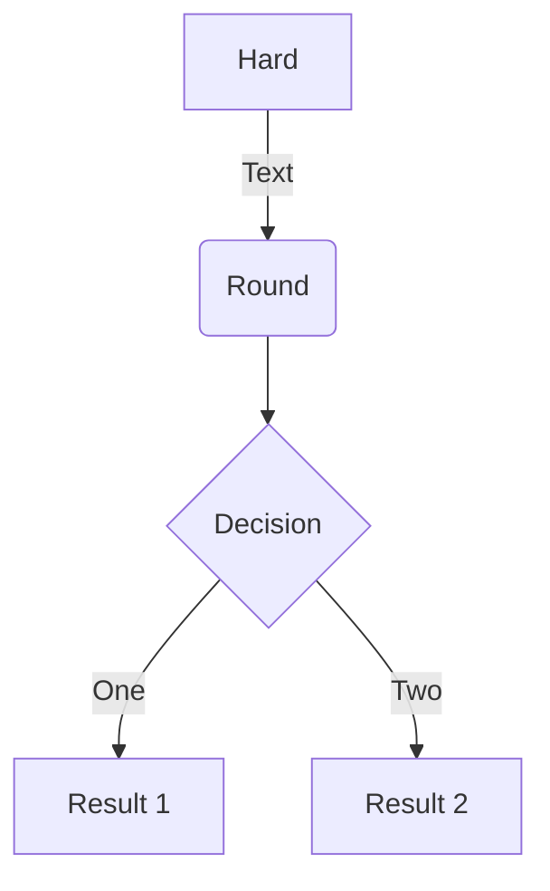
````

<div class="mermaid">
flowchart TD
%% flowchart有实验功能，如弧线、多头，graph是旧版
A[Hard] -->|Text| B(Round)
B --> C{Decision}
C -->|One| D[Result 1]
C -->|Two| E[Result 2]
</div>

<div class="mermaid">
flowchart LR
A[木] -->|1| B(树)
A --> C((林))
C -->|2| D(森)
C -->|3| E(彬)
A --> D
f{彡} --> E(彬)
</div>

#### 可选方向

* TB - top to bottom
* TD - top-down/ same as top to bottom
* BT - bottom to top
* RL - right to left
* LR - left to right

#### 节点图形
````text
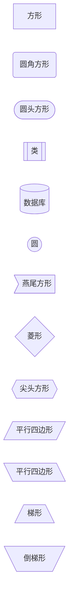
````

<div class="mermaid">
flowchart RL
id1[方形]
id2(圆角方形)
id3([圆头方形])
id4[[类]]
id5[(数据库)]
id6((圆))
id7>燕尾方形]
id8{菱形}
id9{{尖头方形}}
id10[/平行四边形/]
id11[\平行四边形\]
id12[/梯形\]
id13[\倒梯形/]
</div>

#### 线形和线长

|Length | 1 | 2 | 3|
|--|--|--|--|
|Normal | ---|----|----- | 
|Normal with arrow | -->|--->|----> | 
|Thick | ===|====|===== | 
|Thick with arrow | ==>|===>|====> | 
|Dotted | -.-|-..-|-...- | 
|Dotted with arrow | -.->|-..->|-...->|

````text
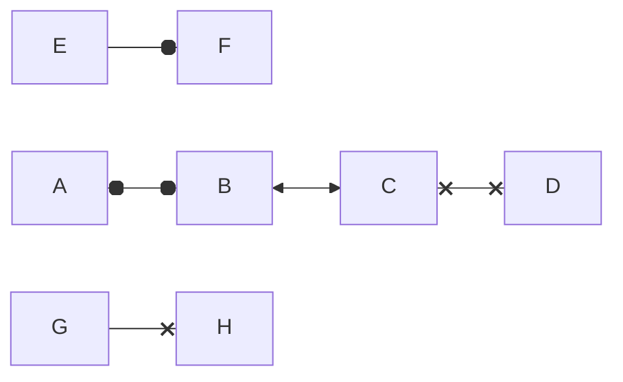
````

#### 子图和子图关系

````text
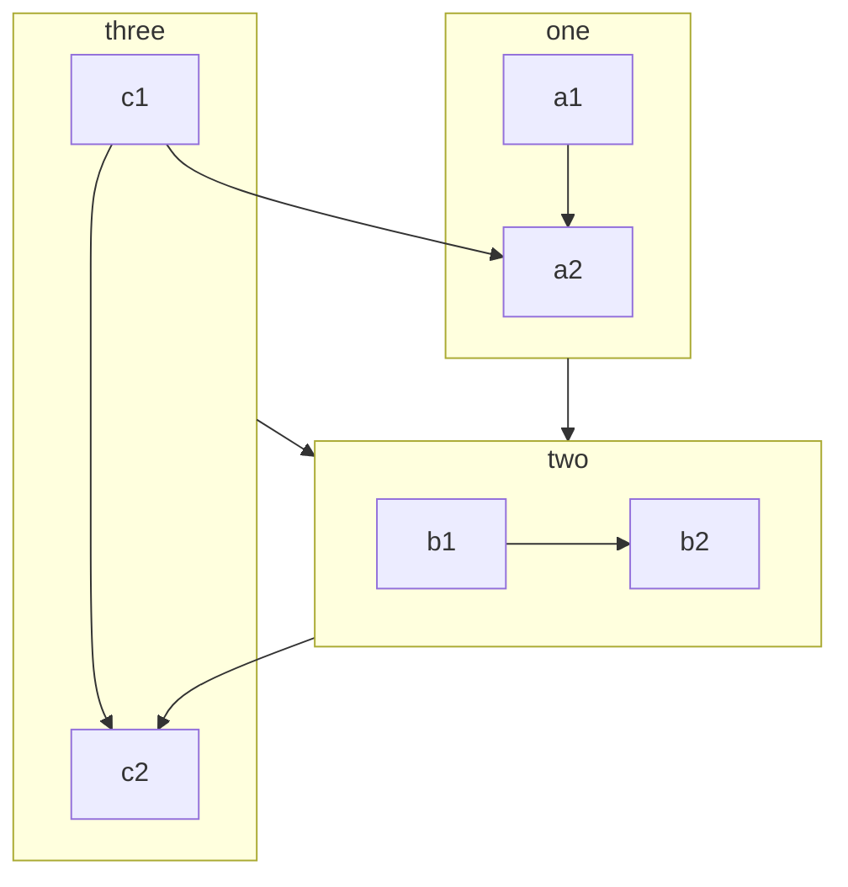
````

<div class="mermaid">
flowchart TB
    c1-->a2

    subgraph one
    a1-->a2
    end

    subgraph two
    b1-->b2
    end

    subgraph three
    c1-->c2
    end

    one --> two
    three --> two
    two --> c2
</div>

### 状态图

适用于描述流程中的有限几种状态。

````text
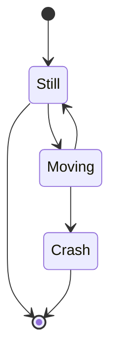
````

<div class="mermaid">
stateDiagram-v2
[*] --> Still
Still --> [*]
Still --> Moving
Moving --> Still
Moving --> Crash
Crash --> [*]
</div>

### 时序图

````text
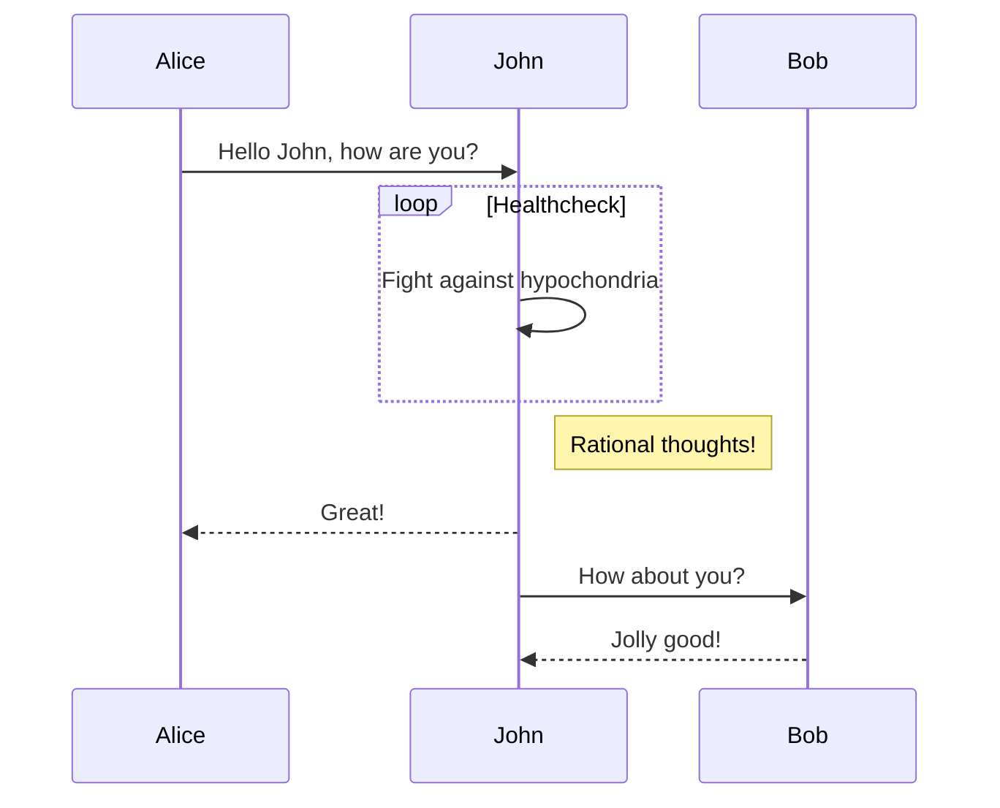
````

<div class="mermaid">
sequenceDiagram
Alice->>John: Hello John, how are you?
loop Healthcheck
    John->>John: Fight against hypochondria
end
Note right of John: Rational thoughts!
John-->>Alice: Great!
John->>Bob: How about you?
Bob-->>John: Jolly good!
</div>

### 甘特图

````text
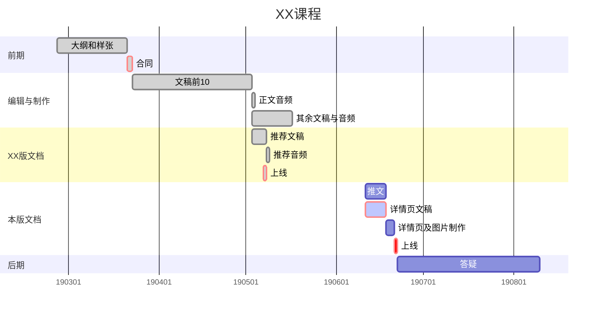
````


<div class="mermaid">
gantt
dateFormat  YYYY-MM-DD
axisFormat %y%m%d
title XX课程

section 前期
    大纲和样张 :      done, des1, 2019-02-25, 2019-03-21
    合同      :crit,  done, contract, after des1, 2d

section 编辑与制作
    文稿前10       :done, text10, after contract, 2019-05-03
    正文音频       :done, 1d
    其余文稿与音频 :done, after text10, 2019-05-17

section XX版文档
    推荐文稿       :done, after text10, 5d
    推荐音频       :done, 1d
    上线           :crit, done, 2019-05-07, 1d

section 本版文档
    推文            :2019-06-11, 7d
    详情页文稿       :crit, active, spec, 2019-06-11, 7d
    详情页及图片制作 :3d
    上线            :crit, 24h

section 后期
    答疑 :7w
</div>

### 行程图

````text
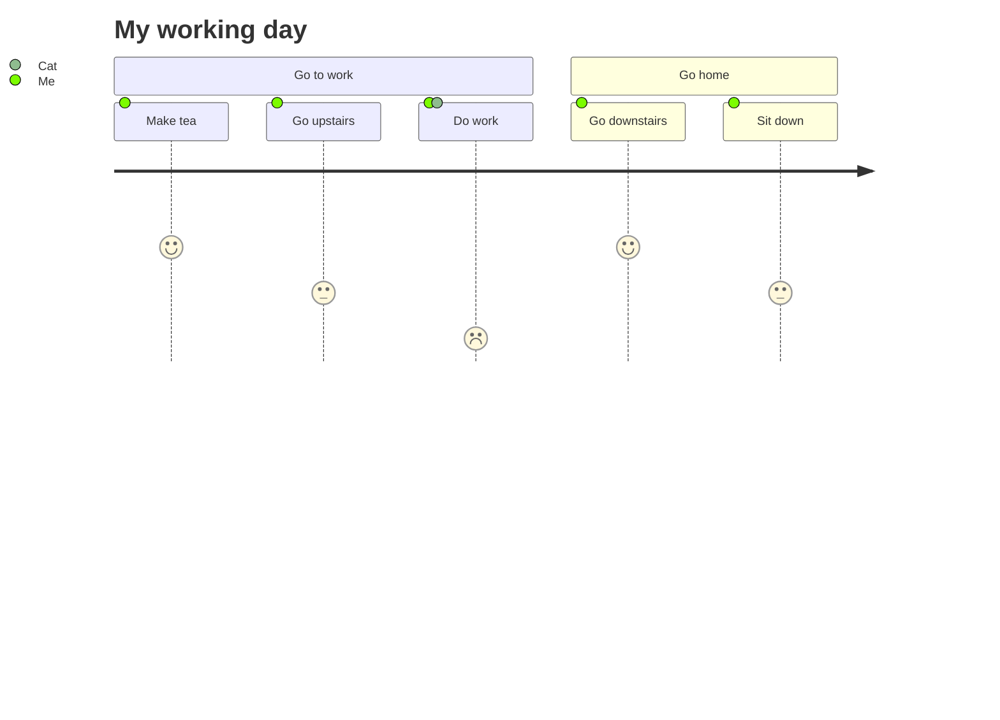
````

<div class="mermaid">
journey
title My working day
section Go to work
    Make tea: 5: Me
    Go upstairs: 3: Me
    Do work: 1: Me, Cat
section Go home
    Go downstairs: 5: Me
    Sit down: 3: Me
</div>


### [类图/UML](https://mermaid-js.github.io/mermaid/#/classDiagram)

````text
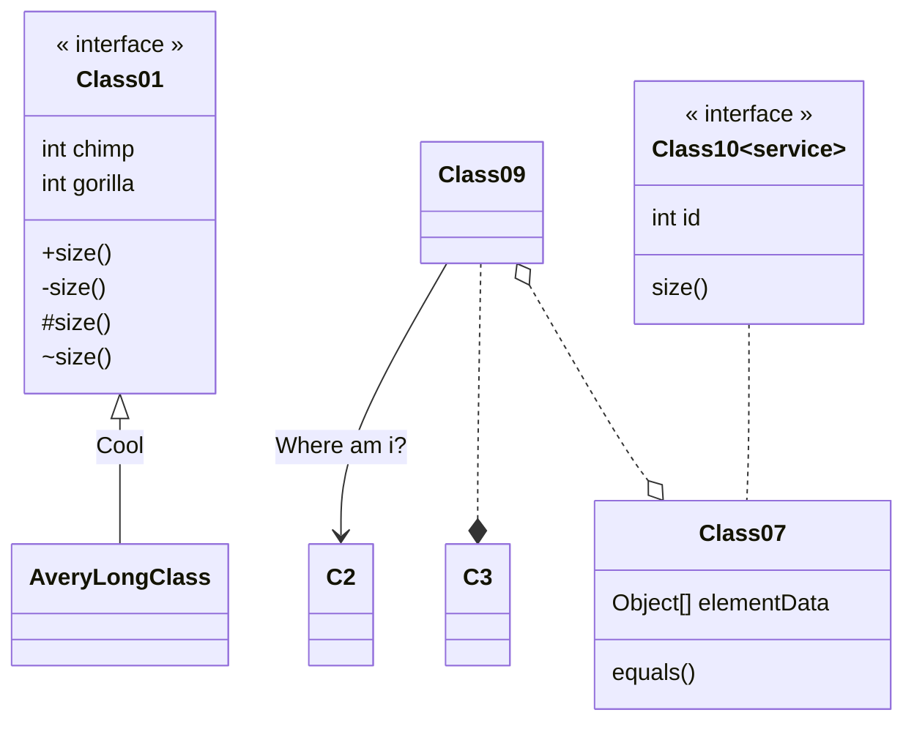
````

<div class="mermaid">
classDiagram
%% 尖括号后必须有空格
class Class01  {
    << interface >>
    int chimp
    int gorilla
    +size()
    -size()
    #size()
    ~size()
}
Class01 <|-- AveryLongClass : Cool
Class09 --> C2 : Where am i?
Class09 ..* C3
Class09 o..o Class07
Class07 : equals()
Class07 : Object[] elementData
class  Class10 ~service~ {
        << interface >>
    int id
    size()
}
Class10 .. Class07
</div>

<div class="mermaid">
classDiagram
classA --|> classB : Inheritance
classM ..|> classN : Realization
classC --* classD : Composition
classE --o classF : Aggregation
classG --> classH : Association
classK ..> classL : Dependency
classI -- classJ : Link(Solid)
classO .. classP : Link(Dashed)
</div>

完整的关系语法：
```text
[classA] "cardinality1" [Arrow] "cardinality2" [ClassB]:LabelText
```

cardinality/基数 :

* 1 Only 1
* 0..1 Zero or One
* 1..\* One or more
* \* Many
* n n {where n>1}
* 0..n zero to n {where n>1}
* 1..n one to n {where n>1}

<div class="mermaid">
classDiagram
Customer "1" --> "*" Ticket
Student "1" --> "1..*" Course
Galaxy --> "many" Star : Contains
</div>

### 实体关系图

````text
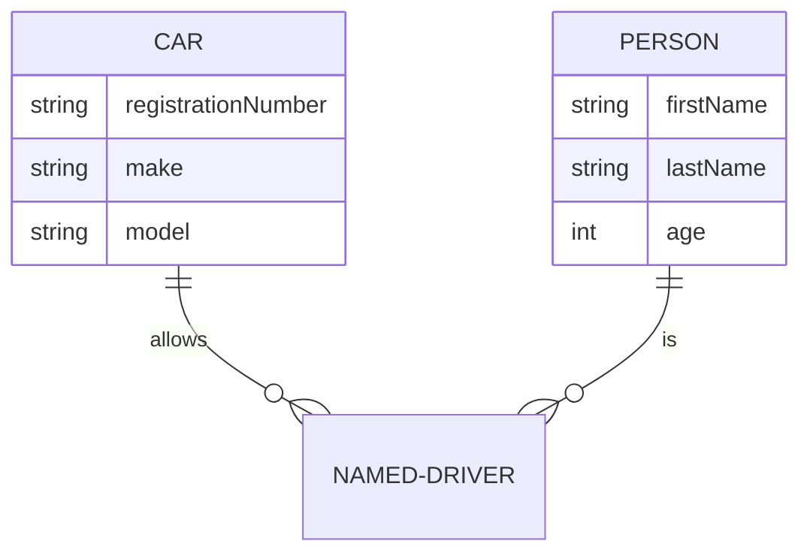
````

<div class="mermaid">
erDiagram
CAR ||--o{ NAMED-DRIVER : allows
CAR {
    string registrationNumber
    string make
    string model
}
PERSON ||--o{ NAMED-DRIVER : is
PERSON {
    string firstName
    string lastName
    int age
}
</div>

### 饼图

````text
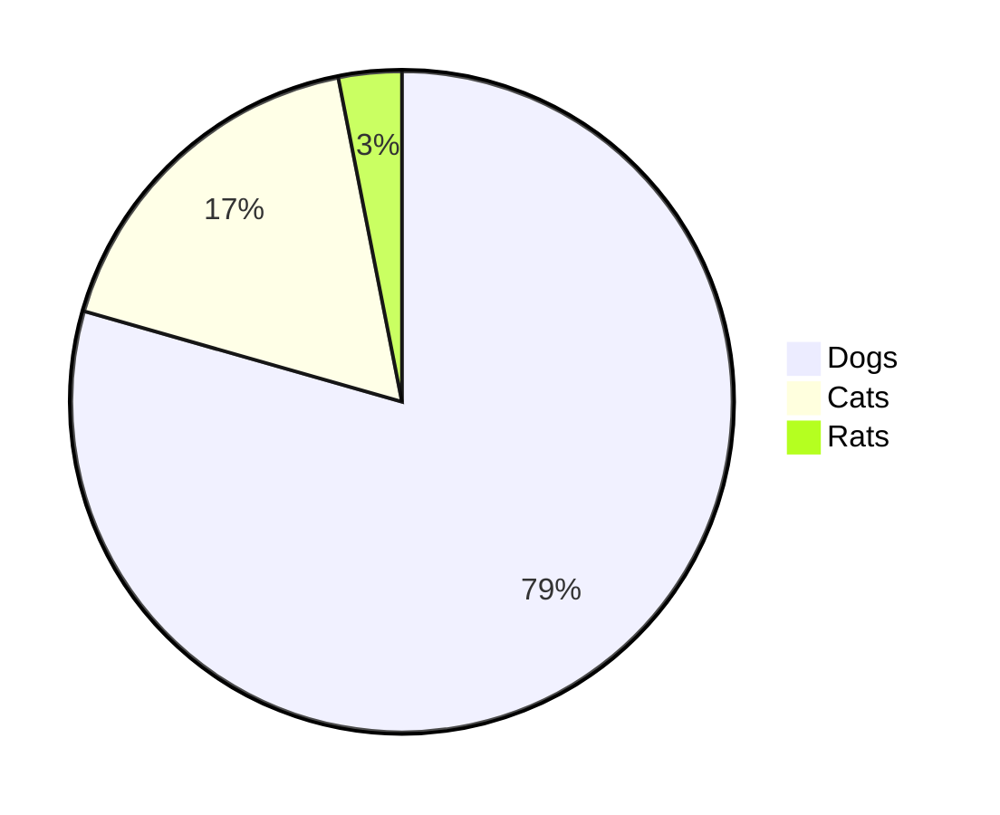
````

<div class="mermaid">
pie
"Dogs" : 386
"Cats" : 85
"Rats" : 15
</div>

### git图(略)

## 嵌入网页

**（嵌入Markdown同样有效）**

````html
<div class="mermaid">
pie
"Dogs" : 386
"Cats" : 85
"Rats" : 15
</div>

<!-- pymdownx.superfences插件提供的pymdownx.superfences.fence_div_format格式化函数也能把围栏中的置入<div class="mermaid"></div>中 -->
<!-- 文档最后加入一次mermaid渲染库与命令 -->

<script src="https://cdn.jsdelivr.net/npm/mermaid/dist/mermaid.min.js"></script>

<script>
    mermaid.initialize({
        // 加载后启动
        startOnLoad:true,
        // 允许点击链接跳转
        securityLevel: 'loose',
        fontFamily: '"楷体","华文楷体","仿宋","宋体"',
        });
</script>
````

## 在mkdocs静态网站中使用

临时使用可以使用上面的方法嵌入Markdown文件中。  
经常使用可以安装插件[mkdocs-mermaid2-plugin](https://github.com/fralau/mkdocs-mermaid2-plugin)。每次更新都会检查所有文件，处理速度有点慢。设置如下：

```yml
plugins:
    - search
    - mermaid2:
        arguments:
            securityLevel: 'loose' # 允许图中加入链接
            startOnLoad: true # 加载后启动
            fontFamily: '"楷体","华文楷体","仿宋","宋体"'
```

<!-- 本页所需的嵌入脚本 -->

<!-- pymdownx.superfences插件提供的pymdownx.superfences.fence_div_format格式化函数也能把围栏中的置入<div class="mermaid"></div>中 -->
<!-- 文档最后加入一次mermaid渲染库与命令 -->

<script src="https://cdn.jsdelivr.net/npm/mermaid/dist/mermaid.min.js"></script>

<script>
    mermaid.initialize({
        // 加载后启动
        startOnLoad:true,
        // 允许点击链接跳转
        securityLevel: 'loose',
        fontFamily: '"楷体","华文楷体","仿宋","宋体"',
        });
</script>
