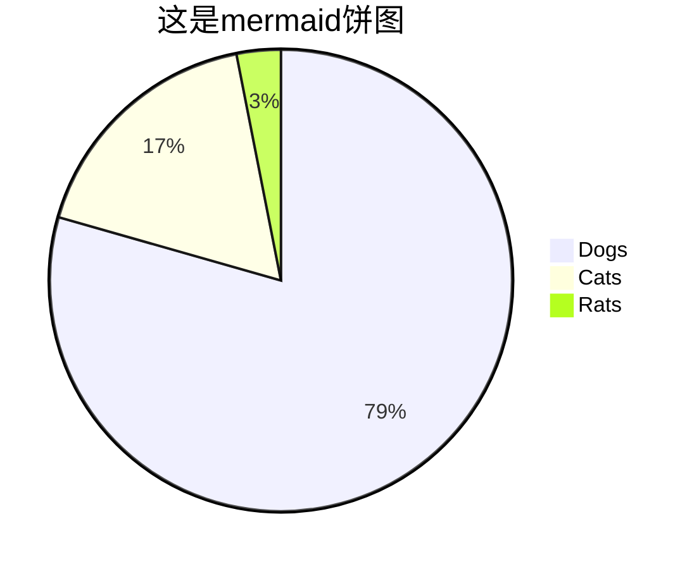

# 一级标题
## 二级标题
### 三级标题。通常支持六级标题

正文第一段
还是第一段（连续多行在渲染时会被连成一段）

正文第二段
还是第二段（空行才是段落标记，不管多少个空行，效果不变）

> 这是引文段落
> 这是引文段落

* 无序列表
    * 列表可嵌套
* [x] 任务列表
    * [ ] 任务列表

2. 有序列表
1. 有序列表（渲染时会自动从第一个编号开始连续递增编号，即序号会变成2、3）

这是*斜体*标记
这是**粗体**标记

这是~~删除线~~标记，这是HTML<s>删除线</s>标记

这是HTML<u>下划线</u>标记

这是HTML<del>删除文本</del>标记，这是HTML<ins>插入文本</ins>标记

这是^上标^ 这是HTML<sup>上标</sup>
这是~下标~ 这是HTML<sub>下标</sub>

这是`行内代码`引用标记。这是代码块引用标记（也支持markdown、text、mermaid等各种非编程语言）：

```python
print('Hello, World!')
```

这是外部链接[xiiiGame](https://blog.xiiigame.com/)

这是文件连接[学习笔记](2022-01-10-给文字工作者的VSCode入门教程.md)

这是文中连接[一级标题](#一级标题)

这是插入图片，可以是本地图片

| 表头 | 表头 |
| ---- | ---- |
| 内容 | 内容 |
| 内容 | 内容 |

这样忽略Markdown标记（符号转义） \*这里不再是斜体而是星号\*

***

<!-- 以上是一条分割线。这里是注释，渲染时被隐藏 -->

以下需要 markdown-preview-enhanced 等插件支持：

脚注[^1]
脚注[^2]

[^1]: 脚注一
[^2]: 脚注二



!!! warning 这是提示卡片
    支持 note, caution, tip, important, warning

这是Emoji :smile:
