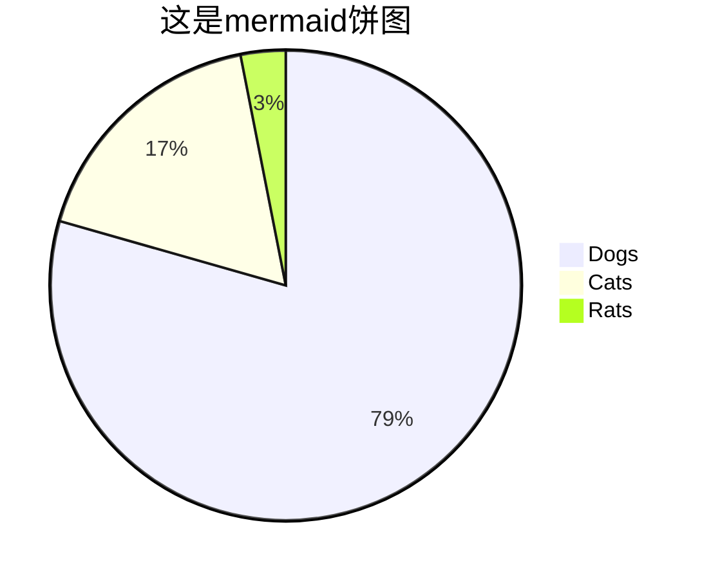

*本文正在写作中。*

慢慢有朋友使用我做的VSCode校对扩展AI proofreader，他们常常不会装软件，设置软件。我写这篇博客，免得每次重复指导。

## 快速安装和体验

已经确信要使用VSCode的朋友，请如下安装、体验：

1. 到[VSCode官网下载页面](https://code.visualstudio.com/download)下载安装程序。一般Windows电脑可下载`System Installer`下的`x64`版本，它对应用户为系统管理员、处理器为64位架构的情形。
2. 双击安装。通常按默认选项安装即可。在菜单中集成“通过Code打开”方便你通过鼠标右键菜单等直接使用VSCode。

3. 安装后可能有一些推荐，关闭窗口即可。程序界面大致如下。
   
4. 如需中文界面，可安装中文语言扩展。点开侧栏扩展按钮（或Ctrl+Shift+X），搜索Chinese，即可看到微软官方的扩展，如下。点击右侧`install`按钮安装，重启后生效。
    
5. 同样的方法可以安装我做的校对扩展AI Proofreader，其安装界面同时也是详细的使用教程。
   
6. 打开一个项目文件夹，或者叫工作空间。VSCode可以直接处理单个文件（可能有安全和功能受限的提示），但它最常见的用途是程序员用来管理代码库，也就是一个文件夹下的所有内容。文字工作者也可以用来管理写作项目、编辑项目等，比如把编辑一本书相关的所有材料放在一个文件夹下，然后用VSCode菜单File => Open Folder（Ctrl+K Ctrl+O）打开这个文件夹。也可以在文件夹上、文件夹内空白处，通过鼠标右键菜单打开。
   
7. 新建README.md文件。点开侧栏文件浏览按钮（或Ctrl+Shift+E），就能看到文件夹/工作空间浏览窗口，鼠标经过时能看到上边有新建文件、新建文件夹、折叠/展开文件路径等按钮。跟大多数编辑软件一样，也可以通过文件菜单来新建文件，或直接用快捷键Ctrl+N来实现。新建文件时使用`.md`为后缀，即表示我们下面要讲到的Markdown文件。按照程序员的最佳实践，每个项目应该在根目录中新建一个README.md文件，对项目进行说明，记录项目信息等。

## 除了Word和WPS，还有很多有趣的写作工具

*如果你急着体验VSCode的强大功能，可以直接阅读[文本编辑操作举例](#vscode-文本编辑操作举例)一节。*

你可能会问：我为什么要用这个看起来很复杂、过于技术化的编辑器？我只想好好写字、编辑文字，我不需要太多功能。

文字工作者常常只用Word、WPS处理文字，甚至分不清这两个软件。这些朋友错过了很多好工具。当然，这常常不重要。那我换一种说法：他们错过了一些相当好玩的东西。

在这个博客中，我面向文字工作者介绍VSCode，这是我用得最多的文字处理软件。在需要与人协作编辑的场合，我使用LibreOffice Writer、WPS、Word三者中的一个。 [^1] 在处理特大文件时偶尔用EmEditor，某些涉及中文特性的处理也用TextPro。 [^2] [^3] 在这些情形之外，我通常只用VSCode，包括编辑和校对书稿、管理编辑项目、做笔记、写博客（正如你看到这一篇）等，当然也用来编程和管理开源项目。

[^1]: [libreoffice使用问题](2021-09-01-libreoffice使用问题.md)
[^2]: [用正则表达式处理文本、管理文件的三件套](2020-10-26-用正则表达式处理文本、管理文件的三件套.md)
[^3]: [给编辑朋友的正则表达式课程](2020-05-31-给编辑朋友的正则表达式课程.md)

## Word、WPS的好处和问题

Word、WPS、Libreoffice Writer是面向办公的、所见即所得的（What You See Is What You Get, WYSIWYG）“字处理软件”，特点是用户一边打字，一边就可以排版，并立即看到最终打印到纸上的效果。——手写文书自动化、替代打字机，正是此类软件的初心。

这是此类软件的最大好处。

但是，这类软件有一些麻烦的问题。
因格式繁杂，解析、渲染困难，导致很多不便，如：

1. 不同用户可能使用不同的方式来实现同一种效果，导致无法统一操作，无法复用。比如很多朋友不会使用标题段落样式，而是用模拟的办法来做，用二号宋体加粗居中表示一级标题，用四号黑体居中表示三级标题，看起来没问题，但不能自动生成目录，不能查看大纲视图（对于长文档来说，大纲能让你始终保持整体感），也难以跟别人文档的一级标题、三级标题保持一致。
2. 许多快捷操作受限。比如Word、WPS可以多光标/列式选择、复制，却不能多光标/列式粘贴、输入。又比如文件内的查找、替换，Word、WPS直到现在都不支持正则表达式——一种最流行的文本匹配语言；Libreoffice Writer提供有限支持。
3. 软件自身很少有多文件批量操作，如批量查找替换、内容帅选。如果文档比较长，机器老旧，单文件操作都可能困难。

此类软件的好处是“所见即所得”，但并非总是所见即所得：

1. 同一个文件在不同软件中的排版效果常常不同，甚至有错乱，打不开。
1. 甚至同一个软件，文件格式版本与软件版本之间也可能有兼容性问题。

更重要的是，Word、WPS是闭源商业软件，Libreoffice Writer虽然是开源软件，却严格对标Word（WPS同样严格对标Word），所以整体上比较沉闷，社区缺乏活力，缺乏创新。这是很多问题的原因。

## VSCode + Markdown的问题和好处

本文把VSCode看作文本编辑器，就文字工作者而言，目前最常用的文本类型是Markdown，一种轻量级文本格式标记语言。所以，本文的假设情境是VSCode + Markdown写作。

Markdown文件是“文本”意味着，用文本文件编辑器打开时，你看到的主要是文本符号，并且没有隐藏内容。——当然，有一些看不见的字符，比如换行符。而在Word这样的软件中，在你看到的文本符号之后，还隐藏着许多信息，如字体字号、颜色、修改历史、段落样式，等等。

Markdown是“轻量级文本格式标记语言”是说，你看到的文本不全表示字面的意思，有“少量”文本表示的是文本格式。比如这样的一行是 `## 这是二级标题行` 。尽管你在编辑Markdown文件时可能看到标题的颜色和字号不同于正文，但这种样式并非Markdown文件本身规定的，而是编辑器赋予的。就是说，Markdown的文本格式标记只是类别标记，跟实际显示效果没有直接关联。

这样一来，与“所见即所得”相对，你的处理模式就变成了“所思即所得”（Waht You Think Is What You Get, WYTIWYG）。你“想”它是二级标题，在行头加上`## `，它就是二级标题。但它最终是什么样子呢？是不确定的。或者说，写作者，至少在写作时，只关心他的抽象类别，并不关心它的视觉效果。

这样，写作与呈现两个环节得以解耦。这种解耦的好处不少：

1. 简化头绪。写作者只要关心样式类别，不需要关系样式的视觉效果。
2. 抽象统一。方便作者保持自己的一致性。也方便读者、展示平台（如博客平台、阅读器、预览插件）获得统一的视觉效果，并可随时变更。

Markdown最初是程序员撰写程序文档和技术博客的格式，它适应的是“一处写作，随处发布”的互联网写作流。

VSCode + Markdown文字处理还有很多好处。说明这个组合的功能和好处正是本文的整体目标，所以此处就不多说了。

这个组合的问题（也可以说成优点），首先，自然是你不知道你“所思”的实际“所得”将是什么，你在写作阶段不得不放弃对最终视觉效果的控制。

第二个问题，“简化”和“统一”并非总有保障。你可能注意到了，“轻量”“少量”可能暗藏陷阱。Markdown其实是“一类”而不是“一种”语言，关键在渲染工具支持多少样式、支持哪些样式，以及怎样支持。

VSCode自带Markdown预览插件，不过我常用Markdown Preview Enhanced扩展来预览，功能比较多，如支持脚注、数学公式和mermaid图表，可以导出PDF，对于处理一般书稿已经够用。

如果你觉得这还不够，你还可以安装许多扩展来增强你的Markdown预览功能与效果。还可以自己配置跟Word文档常用样式一致的样式，从而替代Word。

Markdown兼容互联最通行的前端展示语言HTML（或者叫“网页格式”），因此，网页上看到的效果Markdown都能实现；反过来，Markdown渲染后就是HTML网页，拷贝到微信公众号、各种博客平台通常也能保持显示效果。——这就是“一处写作，随处发布”的意思。

Markdown可以改造得很强大、很漂亮，但不要忘记Markdown的初心——一种轻量级文本格式标记语言。为自己经常用到的公司公文模版、许多同学用到的学校论文模版配置样式也许值得，为自己的项目说明配置样式则似无必要。

就我个人而言，最好的状态是不要打开预览界面，保持Markdown在编辑器内自然可读。样式标记一旦影响阅读，就要想着简化了。

## 背景可靠，学会了用二十年没问题

与VSCode类似的软件不少，但综合来说，VSCode最活跃，也最有前途。VSCode是微软的开源代码编辑器，与微软的GitHub托管平台深度融合，目前是用户量最大的代码编辑器，社区庞大而活跃。

尽管HTML是前端显示（现在的Word格式docx也是HTML格式）的实际格式，但Markdown是最常见的写作格式。

对于文字工作者来说，VSCode + Markdown 这个组合，你学了之后，舒服地使用二十年没问题。

## 文本编辑器和代码编辑器有什么区别

你可能会问，文本编辑器和代码编辑器有什么区别？文本编辑器是不是更适合我？

笼统来说，代码编辑器就文本编辑器，而文本编辑器不一定是代码编辑器。又因为编程行业比文字行业大得多、活跃得多，而且代码编辑器的作者和使用者都是程序员，自造自用，因此代码编辑器通常比专用文本编辑器功能强大，扩展灵活，社区活跃。实际上，比起代码编辑器来，专用文本编辑器确实少得多，老旧得多。

专用文本编辑器可能会有某些特有的文字处理功能，不过这些功能也很容易被程序员移植到代码编辑器中。VSCode有一个非常庞大的扩展市场，你能想到的常用功能，即使如果官方没有实现，通常也能通过扩展实现。

## Markdown常用标记

此类信息很多，这里只介绍最常见标记，实际效果见[Markdown常用标记示例](2022-01-10-给文字工作者的VSCode入门教程-Markdown常用标记示例.md)

``````markdown

# 一级标题
## 二级标题
### 三级标题。通常支持六级标题

正文第一段
还是第一段（连续多行在渲染时会被连成一段）

正文第二段
还是第二段（空行才是段落标记，不管多少个空行，效果不变）

> 这是引文段落
> 这是引文段落

* 无序列表
    * 列表可嵌套
* [x] 任务列表
    * [ ] 任务列表

2. 有序列表
1. 有序列表（渲染时会自动从第一个编号开始连续递增编号，即序号会变成2、3）

这是*斜体*标记
这是**粗体**标记

这是~~删除线~~标记，这是HTML<s>删除线</s>标记

这是HTML<u>下划线</u>标记

这是HTML<del>删除文本</del>标记，这是HTML<ins>插入文本</ins>标记

这是^上标^ 这是HTML<sup>上标</sup>
这是~下标~ 这是HTML<sub>下标</sub>

这是`行内代码`引用标记。这是代码块引用标记（也支持markdown、text、mermaid等各种非编程语言）：

```python
print('Hello, World!')
```

这是外部链接[xiiiGame](https://blog.xiiigame.com/)

这是文件连接[学习笔记](2022-01-10-给文字工作者的VSCode入门教程.md)

这是文中连接[一级标题](#一级标题)

这是插入图片，可以是本地图片

| 表头 | 表头 |
| ---- | ---- |
| 内容 | 内容 |
| 内容 | 内容 |

这样忽略Markdown标记（符号转义） \*这里不再是斜体而是星号\*

***

<!-- 以上是一条分割线。这里是注释，渲染时被隐藏 -->

以下需要 markdown-preview-enhanced 等插件支持：

脚注[^1]
脚注[^2]

[^1]: 脚注一
[^2]: 脚注二



!!! warning 这是提示卡片
    支持 note, caution, tip, important, warning

这是Emoji :smile:


``````

如果使用markdown-preview-enhanced预览扩展，可参考其文档中的一部分：[Markdown基本元素](https://shd101wyy.github.io/markdown-preview-enhanced/#/zh-cn/markdown-basics)

## VSCode的快捷操作

如果用得多，很有必要学一些 [常用技巧 tips-and-tricks](https://code.visualstudio.com/docs/getstarted/tips-and-tricks)和快捷键。

这里是完整的[快捷键 keyboard-shortcuts-windows](https://code.visualstudio.com/shortcuts/keyboard-shortcuts-windows.pdf)，可以打印出来。

下面挑出一些常用的。

* 快捷导航
    * Ctrl+Shift+P 命令面板，可以输入关键字筛出命令，比如用`aiproof`能筛出我做的AI Proofreader扩展的所有命令。刚使用过的命令再次查询时默认选中，回车即可执行，很方便。
    * Ctrl+P 文件浏览面板，跟命令面板类似，能筛出项目所有文件名，用Down和Right键快速打开。
    * Ctrl+G 位置跳转，快速跳转到指定行号。
    * Ctrl+Shift+O 符号跳转，快速筛出、跳转到当前文档指定标题，输入#筛出标题级别（Markdown文档只有标题这一种符号）
* 文件操作，跟其他软件类似
    * Ctrl+N 新建文件 
    * Ctrl+S 保存文件 
    * Ctrl+W 关闭编辑窗口 
    * Ctrl+Tab 切换到后一个文件
    * Ctrl+Shift+Tab 切换到前一个文件
* 编辑，常用操作跟其他软件类似，又有很大增强
    * Ctrl+C 拷贝(无选择时拷贝整行)
    * Ctrl+X 剪切(无选择时剪切整行)
    * Ctrl+V 粘贴文字、链接、图片等
    * Alt+ ↑ / ↓ 上下移动当前行
    * Shift+Alt + ↓ / ↑ 上下拷贝当前行
    * Alt+PgUp / PgDn 上下翻页
    * Alt+ ← / → 移动到前后编辑位置
    * Alt+Z 换行开关 
    * Ctrl+] / [ 缩进开关
    * Ctrl+Shift+[ / ] 增加标题级别（需插件支持）
    * Ctrl+/ 注释行开关
* 查找替换
    * Ctrl+F 查找
    * Ctrl+H 替换
    * F3 / Shift+F3 查找上一个/下一个
    * Alt+Enter 选中所有查找的相同项目
    * Ctrl+Shift+F 项目内搜索
    * Ctrl+Shift+H 项目内替换
* 多光标操作
    * Ctrl+D 加选相同项目
    * Alt+Click 插入一个光标
    * Ctrl+U 取消最后一个光标
    * Ctrl+Shift+L 选中所有与选中项相同者
    * Shift+Alt + (鼠标拖拽) 列块选择
* 显示
    * F11 全屏开关
    * Ctrl+ = / - 放大与缩小
    * Ctrl+B 侧栏开关
    * Ctrl+Shift+E 浏览器
    * Ctrl+Shift+X 扩展
    * Ctrl+Shift+V 预览Markdown文件

## VSCode 文本编辑操作举例

### 多重选择和多光标编辑

**多重选择：** 按住Ctrl键，然后可以用鼠标选中多段内容。

**扩展选择：** 选中一段文字，然后按ctrl+D，可以选中下一处与相同的文字，如此继续可以选中更多。如果想一次性选中所有相同文字，可以使用Ctrl+Shift+L；如果此时查找窗口打开且其中有正则表达式，则选中的是正则匹配，而不是选中的相同项。

**列选择：** 按住Alt键，然后用鼠标拖动，可以进行列选择。在有空行的情况下，选择内容能跳过空行；不选中，仅插入光标，则不会跳过空行。列选择和列表编辑时最好切换的不换行状态（Alt+Z），以免串行。

获得多个光标焦点后，就可以像单光标编辑一样同时编辑这些地方了。比如移动光标，比如插入序号，比如移动到行头或行尾，选择到行头或行尾。

也可以复制这些内容，然后粘贴到多个光标处；前后数量一致时是一对一插入，不一致时是每处插入所有内容。

### 查找替换

**文件内查找（Ctrl+F）、替换（Ctrl+H）。** 把鼠标悬浮在对话框按钮上，可以看到功能提示。


**整个工作空间/项目文件夹中的查找（Ctrl+Shift+F）、替换（Ctrl+Shift+H）。** 用快捷或侧栏按钮打开替换窗口，对整个文件夹进行查找替换，支持正则表达式、文件名过滤等许多强大功能。


使用正则表达式是查找替换的最高技能。需要专门讲。

查找替换容易出错，要多加小心，或逐条确认，或做好备份、版本管理，以备复核。在批量查找替换前用Git做一次提交是最好的方案，那么我们接下来讲一点点。

### 正则表达式

正则表达式也许是最适合文字工作者学习的通用计算机知识了。据说中华书局的很多青年编辑都会正则表达式，并自称为“正则青年”。

我写过一篇[给编辑朋友的正则表达式课程](2020-05-31-给编辑朋友的正则表达式课程.md)，这里就不专门讲了，但随时会用到，用例也可能复制到上述课程中。

### 文本比较

### 核对引文一致性

### 核对实体命名一致性

### 检查序号一致性

### 大纲视图

移动板块

### 转换成PDF

### 插入图片

### mermaid图表

## 用Git管理版本


## VSCode的设置

VSCode设置有UI和JSON文件两种形式，入口有多个：

1. UI界面，可以通过关键词过滤选项
    1. 菜单File => Preferences => Settings
    2. 侧栏设置按钮⚙️ => Settings
    3. 快捷键`Ctrl+,`
2. JSON文件：UI界面右上角点击打开设置JSON的图标
3. 命令面板（Ctrl+Shift+P）输入`Preferences: Open Settings (UI)`或`Preferences: Open Settings (JSON)`打开设置界面或设置JSON文件
4. 某个扩展的设置还可以从该扩展的介绍页设置按钮直接进入

对文字工作者比较有用的设置项有：

1. 关闭“高亮与鼠标所在内容相同者”，这是因为另一个必要功能“高亮与选中内容相同者”： `"editor.occurrencesHighlight": "off",`。这样一来，你选中一个字词，右侧滚动条上会显示该字词及所有相同者在文档中的位置。这一功能用来检查重复、是否一致很有用，比如多个译名之间、引文与原文、标题与正文是否一致。
2. 显示空格、控制字符等不可见字符，以便你对文档内容有绝对把握：`"editor.renderWhitespace": "all",`和`"editor.renderControlCharacters": true,`
3. 回行宽度。窄一点便于阅读。也可以根据打印、印刷实际宽度设置。单位是一个半角字符，一个汉字合两个半角字符。30个汉字宽度即是：`"editor.wordWrapColumn": 60,`。当窗口实际小于你的设置值时，如果希望文字继续缩窄而不是超出边界外，则设置`"editor.wordWrap":"bounded",`。
4. Markdown中的图片粘贴位置（相对于Markdown文件的位置）。使用Ctrl+V粘贴图片时，自动把图片放到img文件夹下的与文件同名文件夹中：`"markdown.copyFiles.destination": {"**/*": "img/${documentBaseName}/"},`。这样设置，多个Markdown文件的图片都会放到img下，并且用子文件夹分别放，不会混在一起。
5. 颜色主题，也就是界面配色。审美不讲道理。默认为极客风暗色主题，可以换各种配色，比如默认浅色主题：`"workbench.colorTheme": "Default Light Modern",`
6. 编辑器字体、字号、行高。也是审美问题。全局字体我用的是默认设置。但**针对Markdown**设置为Sarasa Mono SC（思源黑体等宽版），主要是为了制表符、表格对齐和多列编辑。行高设为字高的1.6倍。如：
    ```json
    // Markdown语言关联设置，覆盖全局设置
    "[markdown]": {
        "editor.fontFamily": "'Sarasa Mono SC'",
        "editor.lineHeight": 1.6,
    }
    ```

从我的设置中选了对文字工作者可能有用的设置，放在下面。可以复制到你的`settings.json`中。如果有冲突，通常会有提示。

```json
{
    // 
    // 窗口设置
    // 
    // 面包屑（编辑器上方文件路径，可跳转）
    "breadcrumbs.enabled": true,
    // 面板位置（终端、输出、问题等面板）
    "workbench.panel.defaultLocation": "right",
    // 主题（默认为暗色主题，改为浅色主题）
    "workbench.colorTheme": "Default Light Modern",

    // 
    // 编辑器设置
    // 
    // 显示文档缩略图
    "editor.minimap.enabled": false,
    // 显示空格
    "editor.renderWhitespace": "all",
    // 显示控制字符
    "editor.renderControlCharacters": true,
    // 括号对分别着色
    "editor.bracketPairColorization.enabled": true,
    // 括号对引导线
    "editor.guides.bracketPairs": "active",
    // 缩进引导线颜色自定义
    "workbench.colorCustomizations": {
        "editorIndentGuide.activeBackground1": "#ff0000",
        "editor.lineHighlightBackground": "#1073cf2d",
        "editor.lineHighlightBorder": "#9fced11f"
    },
    // 键盘移动光标或backspace时，会按照制表位移动或删除
    "editor.stickyTabStops": true,
    // 高亮与鼠标所在内容相同者
    // 因与另一个必要功能（高亮与选中内容相同者）冲突而关闭
    "editor.occurrencesHighlight": "off",
    // 单词分隔符设置，方便中文处理
    "editor.wordSeparators": "`~!@#$%^&*()-=+[{]}\\|;:'\",.<>/?～·！￥…（）—【】〔〕、；：’‘”“，。《》〈〉？",
    // Unicode特殊字符（歧义、不可见、非一般ascii）高亮，可按需打开
    "editor.unicodeHighlight.ambiguousCharacters": true,
    "editor.unicodeHighlight.invisibleCharacters": true,
    "editor.unicodeHighlight.nonBasicASCII": false,
    "editor.unicodeHighlight.includeComments": true,

    // Markdown语言关联设置，覆盖全局设置
    "[markdown]": {
        // 编辑器换行宽度（半角字符数）
        "editor.wordWrapColumn": 60,
        // 在换行宽度和窗口宽度之间取较小值换行
        "editor.wordWrap":"bounded",
        // 保存时不删除行尾空白字符
        "files.trimTrailingWhitespace": false,
        // 设置等宽字体，以便中英文对齐
        "editor.fontFamily": "'Sarasa Mono SC'",
        "editor.quickSuggestions": {
            "comments": "on",
            "strings": "on",
            "other": "on"
        },
    },
    // 删除行尾空白字符。全局设置
    "files.trimTrailingWhitespace": true,

    // 
    // Markdown官方扩展设置
    // 
    // 图片粘贴位置设置（相对于Markdown文件的位置）
    "markdown.copyFiles.destination": {
        "**/*": "img/${documentBaseName}/"
    },
    // 列表缩进设置（继承编辑器缩进设置）
    "markdown.extension.list.indentationSize": "inherit",

    // 
    // 比较编辑器设置
    // 
    // 显示移动的块（不一定准确）
    "diffEditor.experimental.showMoves": true,
    // 最大计算时间（毫秒），0为不限制
    "diffEditor.maxComputationTime": 0,
    // 启用换行
    "diffEditor.wordWrap": "on",
    // 隐藏未更改区域时的上下文行数（仅显示更改区域及指定行数的上下文）
    "diffEditor.hideUnchangedRegions.contextLineCount": 1,
    // 隐藏未更改区域的最小行数
    "diffEditor.hideUnchangedRegions.minimumLineCount": 1,
    // 并排显示（窗口过小时仍会显示为行内式）
    "diffEditor.renderSideBySide": true,
    // 在边界显示还原图标按钮（容易误操作）
    "diffEditor.renderMarginRevertIcon": false,
    // 忽略行尾空白字符的差异
    "diffEditor.ignoreTrimWhitespace": false,
}
```

## 常用扩展

VSCode有一个极其丰富的扩展市场，当你想要什么功能时，应该首先搜索扩展市场。下面列一些我常用、对文字工作者可能有用的。

### [AI Proofreader](https://marketplace.visualstudio.com/items?itemName=HuangFusyong.ai-proofreader)
* Id: HuangFusyong.ai-proofreader
* 作者: Huang Fusyong
* 介绍: 我做的调用大语言模型进行语言文字校对的扩展。也可以自己写提示词，做别的文字处理工作。

### [Word Count CJK](https://marketplace.visualstudio.com/items?itemName=holmescn.vscode-wordcount-cjk)
* Id: holmescn.vscode-wordcount-cjk
* 作者: 张鹏程
* 介绍: 字数统计

### [Text Power Tools](https://marketplace.visualstudio.com/items?itemName=qcz.text-power-tools)
* Id: qcz.text-power-tools
* 作者: Dániel Tar
* 介绍: 文字处理工具，有240多个命令，如筛选行、移除行、插入数字序列、排序、大小写转换、数字转换

### [Insert Sequences](https://marketplace.visualstudio.com/items?itemName=volkerdobler.insertnums)
* Id: volkerdobler.insertnums
* 作者: Volker Dobler
* 介绍: 插入数字、字母、表达式等各种序列

扩展`Insert Sequences`可以在多光标处插入各种文本序列，包括整数、Ascii字符、月份名称、日期，以及任何javascript表达式。有很多选项可选。

选中多个数字加减1、10、0.1，使用内置插件 `emmet` 的命令`increment by ...` 或 `decrement by ...`

`Text Power Tools`也有插入、增加序列的功能。

### [Cursor Align](https://marketplace.visualstudio.com/items?itemName=yo1dog.cursor-align)
* Id: yo1dog.cursor-align
* 作者: Mike Moore
* 介绍: 垂直对齐所有光标（使用空格填充）


### [Markdown Preview Enhanced](https://marketplace.visualstudio.com/items?itemName=shd101wyy.markdown-preview-enhanced)
* Id: shd101wyy.markdown-preview-enhanced
* 作者: Yiyi Wang
* 介绍: Markdown预览增强工具，支持脚注、数学公式、[mermaid图表](https://mermaid.js.org/intro/getting-started.html)、导出PDF等功能，很强大
* [文档](https://shd101wyy.github.io/markdown-preview-enhanced/#/zh-cn/)

### [Markdown All in One](https://marketplace.visualstudio.com/items?itemName=yzhang.markdown-all-in-one)
* Id: yzhang.markdown-all-in-one
* 作者: Yu Zhang
* 介绍: Markdown写作支持，如各种快捷键、生成目录、自动预览等

### [Markdown Table](https://marketplace.visualstudio.com/items?itemName=TakumiI.markdowntable)
* Id: TakumiI.markdowntable
* 作者: Takumi Ishii
* 介绍: Markdown表格编辑工具

### [Open](https://marketplace.visualstudio.com/items?itemName=sandcastle.vscode-open)

Id: sandcastle.vscode-open
作者: sandcastle
介绍: 在VSCode中使用系统默认软件打开文件

### [Print](https://marketplace.visualstudio.com/items?itemName=pdconsec.vscode-print)

Id: pdconsec.vscode-print
作者: PD Consulting
介绍: 打印代码、Markdown等，可以打印行号（Markdown文件须取消渲染选项）。

### [Sync Scroll](https://marketplace.visualstudio.com/items?itemName=dqisme.sync-scroll)
* Id: dqisme.sync-scroll
* 作者: dqisme
* 介绍: 同步滚动两个编辑器窗口

### [Open](https://marketplace.visualstudio.com/items?itemName=sandcastle.vscode-open)
* Id: sandcastle.vscode-open
* 作者: sandcastle
* 介绍: 使用系统默认程序打开当前文件

### [Rainbow CSV](https://marketplace.visualstudio.com/items?itemName=mechatroner.rainbow-csv)
* Id: mechatroner.rainbow-csv
* 作者: mechatroner
* 介绍: 用颜色区分CSV/TSV表格的列

### [tldraw](https://marketplace.visualstudio.com/items?itemName=tldraw-org.tldraw-vscode)
* Id: tldraw-org.tldraw-vscode
* 作者: tldraw
* 介绍: tldraw手绘图工具

### [Calculate](https://marketplace.visualstudio.com/items?itemName=acarreiro.calculate)
* Id: acarreiro.calculate
* 作者: Andrew Carreiro
* 介绍: 选择数学表达式，计算出得数

### [gtfish14_value-sum-up](https://marketplace.visualstudio.com/items?itemName=gtfish1988.gtfish14)
* Id: gtfish1988.gtfish14
* 作者: gtfish1988
* 介绍: 选择多个数字，计算出总和

### [Harper - Grammar / Spell Checking](https://marketplace.visualstudio.com/items?itemName=elijah-potter.harper)
* Id: elijah-potter.harper
* 作者: Elijah Potter
* 介绍: 硬编码的语法和拼写检查工具，效率高，无需联网，目前只支持英文

### [LLM Writing Tool](https://marketplace.visualstudio.com/items?itemName=OlePetersen.lm-writing-tool)
* Id: OlePetersen.lm-writing-tool
* 作者: Ole Petersen
* 介绍: LLM驱动的写作工具。需要API，**不是太稳定，** 可以尝试用于英文语法检查。

### [GitHub Copilot](https://marketplace.visualstudio.com/items?itemName=GitHub.copilot)
* Id: GitHub.copilot
* 作者: GitHub
* 介绍: Github官方的AI工具，需要Github账号，有一定免费额度

### [GitLens — Git supercharged](https://marketplace.visualstudio.com/items?itemName=eamodio.gitlens)
* Id: eamodio.gitlens
* 作者: GitKraken
* 介绍: 视觉化的Git版本管理工具

### [Live Share](https://marketplace.visualstudio.com/items?itemName=MS-vsliveshare.vsliveshare)
* Id: ms-vsliveshare.vsliveshare
* 作者: Microsoft
* 介绍: 实时协作编辑工具

### [Save and Run](https://marketplace.visualstudio.com/items?itemName=wk-j.save-and-run)
* Id: wk-j.save-and-run
* 作者: wk-j
* 介绍: 保存文件时自动运行你设置的终端命令

## 常用资料

* [常用技巧 tips-and-tricks](https://code.visualstudio.com/docs/getstarted/tips-and-tricks)
* [默认键盘绑定 default-keybindings](https://code.visualstudio.com/docs/reference/default-keybindings)
* [快捷键 keyboard-shortcuts-windows.pdf](https://code.visualstudio.com/shortcuts/keyboard-shortcuts-windows.pdf)

